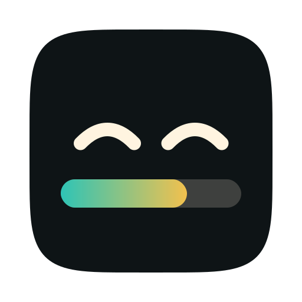
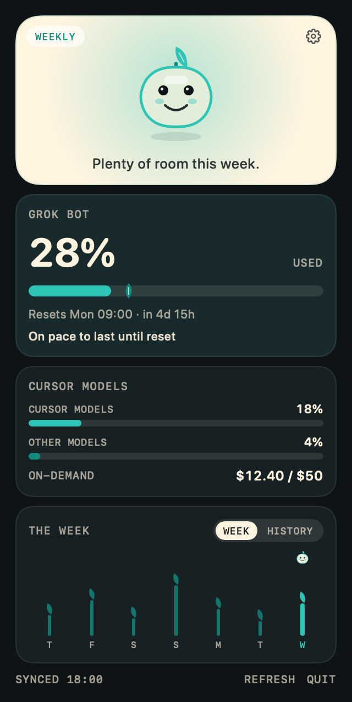
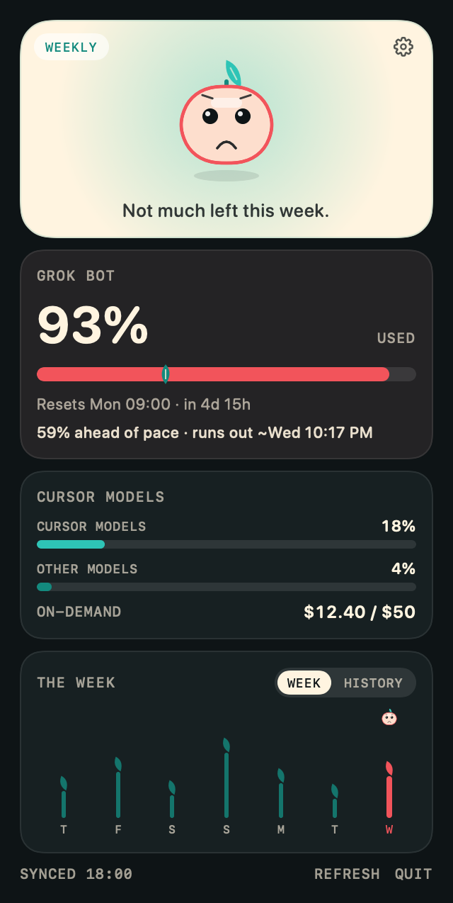
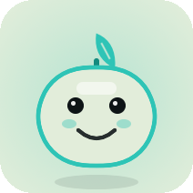
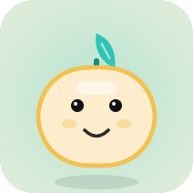
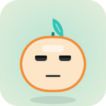
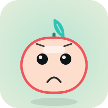
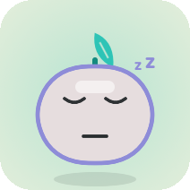

<p align="center">
  
</p>

<h1 align="center">Jollybar</h1>

<p align="center">A jolly little menu bar buddy that keeps an eye on your Grok Bot usage.</p>

<p align="center">
  <a href="https://github.com/exbtpy/jollybar"></a>
  <a href="https://github.com/exbtpy/jollybar"></a>
  <a href="LICENSE"></a>
  <a href="https://github.com/exbtpy/jollybar/releases/latest"></a>
  <a href="https://github.com/exbtpy/jollybar"></a>
</p>

<p align="center">
  <!-- Animated hero, once the file is added: docs/images/hero.gif -->
  
  &nbsp;
  
</p>

## Install

```sh
brew install --cask exbtpy/tap/jollybar
```

Or download [Jollybar.dmg](https://github.com/exbtpy/jollybar/releases/latest/download/Jollybar.dmg).

The app is unsigned for now. The first time you open it, right-click Jollybar and choose **Open**.

## Meet Bud

Bud is the menu bar icon. The face follows the Grok Bot weekly meter. In Settings you can show it as a percent, usage bars, or a tiny Bud, and a few times a day Bud has a little moment: a morning stretch, a sweat drop, a yawn, or a reset-day bounce.

| | Mood | When |
| :---: | --- | --- |
|  | **Playful** | Under 50% used. |
|  | **Steady** | From 50% used. |
|  | **Tired** | From 75% used. |
|  | **Worried** | From 90% used. |
|  | **Asleep** | At 100%, or when the included limit is paused. |

## Features

- **Grok Bot week.** A menu bar meter and a countdown to the reset.
- **Pace.** A leaf marks how far the week has gone, and a forecast says if usage runs out early.
- **Cursor Models and on-demand spend.** Other Models sit with them. When the grok.com account has a SuperGrok pool, that pool is the other menu bar meter.
- **Sprout chart.** Seven days of the weekly rise, plus the longer history chart.
- **Notifications** when Grok Bot or the weekly pool crosses a percent you set.
- **English and Spanish.**
- **Privacy.** Reads your local Grok Bot session, makes no third-party calls, and never refreshes that token.

## How it works

Jollybar reads Grok Bot's local session and calls the same undocumented dashboard endpoints Cursor's usage view uses. It never reads or refreshes that token; open Grok Bot if the session expires. The project is unofficial.

Endpoints, environment variables, Sparkle, and the release steps live in [docs/TECHNICAL.md](docs/TECHNICAL.md). Cutting a release is [docs/RELEASING.md](docs/RELEASING.md).

## Build from source

macOS 14 and Xcode 15 or newer.

```sh
git clone https://github.com/exbtpy/jollybar.git
cd jollybar
make app
```

## Credits and license

Fork of [Blimp-Labs/claude-usage-bar](https://github.com/Blimp-Labs/claude-usage-bar) (BSD-2-Clause). The Grok Bot session reader is adapted from [nuno/grokbot-meter](https://github.com/nuno/grokbot-meter) (MIT). SuperGrok category names follow [blankspeaker/Grok-Rate-Limit-Display](https://github.com/blankspeaker/Grok-Rate-Limit-Display) (MIT). Bud's blink and hop timing borrow from [fayazara/robot-heads](https://github.com/fayazara/robot-heads) (MIT).

[BSD 2-Clause](LICENSE).

Not affiliated with xAI, SpaceXAI, or Cursor.
